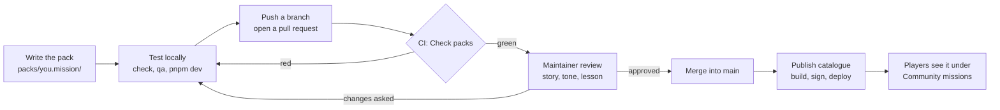

# From your folder to the game: the publishing workflow

This page follows one pack through its whole life: what you do, what the automation does, and what players see. For how to *write* a pack, see [CONTRIBUTING.md](../CONTRIBUTING.md).



## 1. Add a level

1. **Fork** this repository on GitHub (maintainers can work on a branch directly), then clone your fork next to the game:

   ```bash
   git clone https://github.com/<you>/packs.git
   git clone https://github.com/breach-game/breach.git
   cd breach && pnpm install && cd ..
   ```

2. **Create a branch** and a folder named after your pack id, `<your-github-login>.<mission-name>`:

   ```bash
   cd packs
   git switch -c jdoe/lost-backup
   cp -r packs/example.forgotten-backup packs/jdoe.lost-backup     # start from the example
   ```

   Edit `pack.yaml` first: a new `id`, `version: 1.0.0`, your name in `authors`. If your mission needs its own network, copy `packs/example.pixel-world` too, or point `requires` at `breach.world.novamind` to play in the official world.

3. **Write and test** until the three checks of [CONTRIBUTING.md §10](../CONTRIBUTING.md#10-test-your-mission) pass: `check` is green, Ada guides correctly at the three levels, and the mission plays in the game.

## 2. Push it

```bash
git add packs/jdoe.lost-backup
git commit -m "Add jdoe.lost-backup: an old backup left on a shop's web server"
git push -u origin jdoe/lost-backup
```

Then open a pull request against `breach-game/packs` `main`. GitHub fills in the description template: answer each line of the checklist honestly. One pull request per mission (with its world if it brings one) keeps the review simple.

## 3. What happens when you push

**On every push to a pull request**, the *Check packs* workflow (`.github/workflows/check.yml`) runs. It takes about two minutes:

1. It checks out this repository and the game (`breach-game/breach`, branch `main`), and installs the game's tools. Your pack is checked by the very code that will load it.
2. It runs `breach-pack check packs --community --with content`, which:
   - validates every file against the pack schema;
   - applies the safety rules: reserved domains and private addresses only, no script-like text, no control characters, size limits;
   - applies the community rules: id `<name>.<pack>`, no `breach.` prefix, no id already taken, required packs that exist;
   - checks that every text key is translated in every declared language, and that every objective has its guidance;
   - **replays `solution.txt`** in each language: the mission must end with every required objective done.
3. The check is green or red on the pull request. When it is red, open the *Details* link: the log lists each problem as `✗ pack-id: what is wrong`. Fix, commit, push again; the check reruns.

This workflow has read-only access and no secret, so it is safe to run on pull requests from forks. GitHub may ask a maintainer to approve the first run of a new contributor.

**Review.** A maintainer (see `.github/CODEOWNERS`) plays the mission and reads it: is it fictional, does it teach a class of weakness without a reusable exploit, does the debrief explain the defence, is the tone right for players aged 16 and over? Expect comments; push fixes to the same branch.

**On merge into `main`**, the *Publish catalogue* workflow (`.github/workflows/publish.yml`) runs:

1. It checks every pack again, then compiles each one into a `.breachpack` file (gzipped JSON) and writes `index.json`, the catalogue, with the SHA-256 of each file.
2. It **signs `index.json`** with the catalogue's private key (the `BREACH_SIGNING_KEY` secret, which only this workflow can read) and checks that the signature matches the public key built into the game.
3. It deletes anything that is not `index.json`, `index.json.sig` or a `.breachpack` file, and deploys the result to GitHub Pages: https://breach-game.github.io/packs/

**In the game**, a player who opens *Community missions* downloads `index.json` and its signature. The game refuses the catalogue if the signature does not match its built-in key, then downloads the chosen mission, checks its SHA-256 against the catalogue, validates it again with the same schema and safety rules, and caches it for offline play. A mission appears in the list within a few minutes of the merge (GitHub Pages caches files for up to ten minutes).

## 4. Update or withdraw a level

- **Update:** change the files, **raise `version`** in `pack.yaml` (for example `1.0.0` to `1.1.0`), and open a new pull request. Players get the new version the next time they open the list; a save of the old version is not carried over.
- **Withdraw:** a pull request that deletes the folder. After the merge the pack disappears from the catalogue, and the game ignores any older copy of the catalogue it may still have.

## 5. When something goes wrong

| Symptom | Cause and fix |
| --- | --- |
| `host name fb.obj.site is not a reserved domain` | a text key ends with a real top-level domain (`.site`, `.shop`, `.app`…): rename the key |
| `solution.txt does not finish the mission in en (open: …)` | the listed objectives are never completed by the solution: check your rules' event fields (`host` is the host **id**, not its name) |
| `text key … has no translation` | add the key to every `i18n/*.yaml` file |
| `requires breach.world.x, which is not an official pack` | official world ids are listed in the game's `content/worlds/*/pack.yaml` |
| The nightly check turns red with no change here | the game's engine changed: the log says which pack is affected; open an issue or a fix |
| *Publish catalogue* fails at "Sign index.json" | the `BREACH_SIGNING_KEY` secret is missing or does not match the game's key (maintainers only) |
